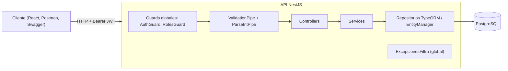
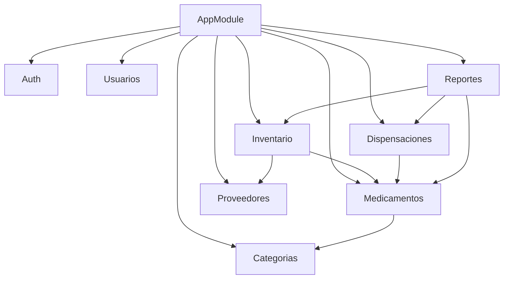
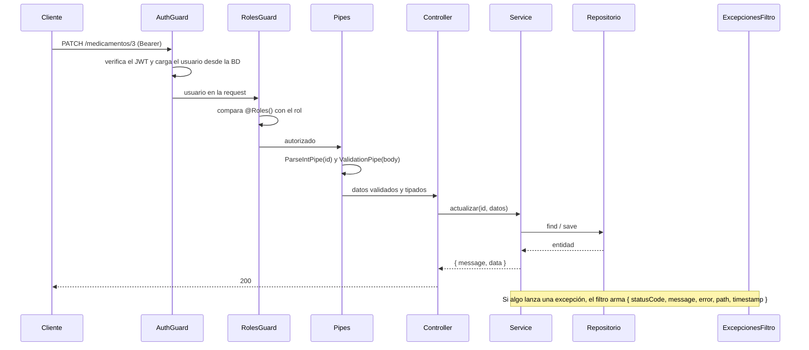
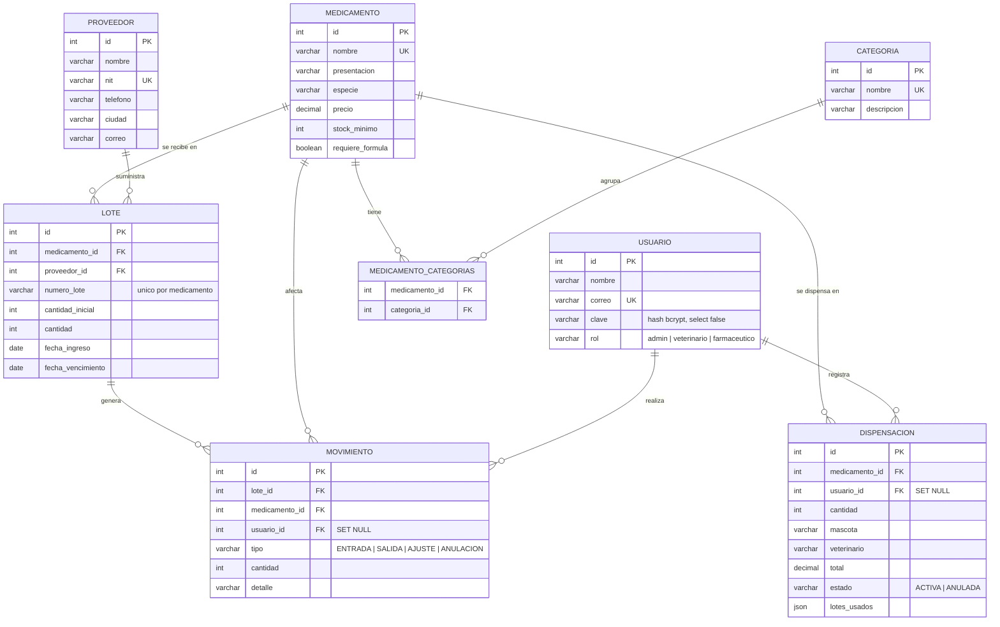
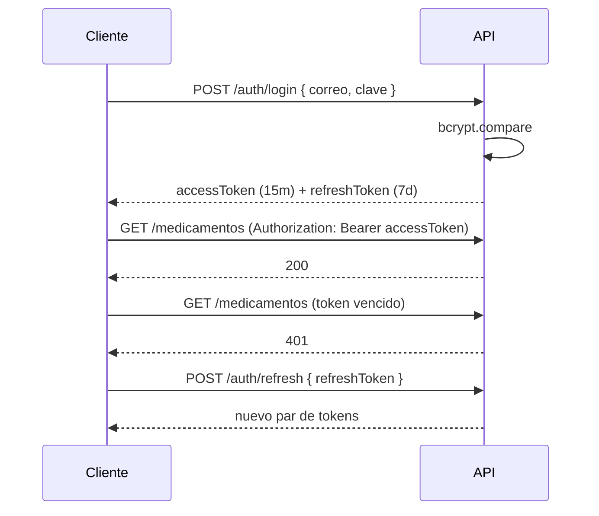

# Arquitectura de VetStock API

Documento técnico de la API: cómo está organizada, cómo viaja una petición, cómo se modelan los datos y por qué se tomaron las decisiones principales.

## 1. Visión general

VetStock es una API REST en NestJS 12 con TypeORM sobre PostgreSQL. Cada recurso es un módulo con la misma estructura por capas:

- **Controller**: solo HTTP (rutas, códigos de estado, extracción de parámetros). Sin lógica de negocio.
- **Service**: toda la lógica (reglas de negocio, transacciones, excepciones).
- **DTO**: forma y validación de lo que entra (`class-validator`) y documentación (Swagger).
- **Entity**: tabla y relaciones TypeORM.

## 2. Mapa de módulos y dependencias

| Módulo | Entidades | Depende de | Exporta |
| --- | --- | --- | --- |
| `AuthModule` | `Usuario` | `ConfigModule`, `JwtModule` | `AuthService`; registra los guards globales (`APP_GUARD`) |
| `UsuariosModule` | `Usuario` | - | `UsuarioService` |
| `CategoriasModule` | `Categoria` | - | `CategoriaService` |
| `MedicamentosModule` | `Medicamento`, `Lote`, `Dispensacion` | `CategoriasModule` | `MedicamentoService` |
| `ProveedoresModule` | `Proveedor`, `Lote` | - | `ProveedorService` |
| `InventarioModule` | `Lote`, `Movimiento` | `MedicamentosModule`, `ProveedoresModule` | `InventarioService`, `MovimientoService` |
| `DispensacionesModule` | `Dispensacion`, `Lote`, `Movimiento` | `MedicamentosModule` | `DispensacionService` |
| `ReportesModule` | (lee las anteriores) | `InventarioModule`, `DispensacionesModule`, `MedicamentosModule` | - |

Inyección de dependencias: un módulo que necesita la lógica de otro **importa el módulo** y recibe su service por el constructor (no vuelve a registrarlo). Los repositorios se inyectan con `@InjectRepository(Entidad)` y por eso cada módulo declara `TypeOrmModule.forFeature([...])`. Los módulos se importan en `AppModule`, que además configura `ConfigModule` (variables de entorno) y la conexión TypeORM.

## 3. Ciclo de vida de una petición

1. **Guards** (antes de todo): `AuthGuard` exige el JWT y consulta el usuario en cada llamada; `RolesGuard` aplica `@Roles()`.
2. **Pipes**: `ParseIntPipe` convierte `:id`; `ValidationPipe` (`whitelist` + `transform`) descarta campos no declarados y responde 400 si el DTO no cumple.
3. **Controller → Service → Repositorio**: el service aplica las reglas y lanza excepciones de Nest (`NotFoundException`, `ConflictException`, ...) con mensajes en español.
4. **Filtro global** (`src/common/filtros/excepciones.filtro.ts`): cualquier excepción termina en el cuerpo uniforme `{ statusCode, message, error, path, timestamp }`. Traduce errores de la BD sin exponer SQL: violación de unicidad a 409, llave foránea a 409, `EntityNotFoundError` a 404, `NOT NULL` y valores fuera de rango a 400; el resto es un 500 genérico (el detalle solo va al log).

## 4. Modelo de datos

Relaciones TypeORM:

- `Medicamento` N:M `Categoria` (`@JoinTable` `medicamento_categorias`; el dueño es `Medicamento`).
- `Lote` N:1 `Medicamento` y N:1 `Proveedor`; sus inversos son `@OneToMany`.
- `Dispensacion` N:1 `Medicamento` y N:1 `Usuario` (nulo si el usuario se elimina).
- `Movimiento` (kardex) N:1 `Lote`, `Medicamento` y `Usuario`.
- Se conservan las columnas `medicamentoId` / `proveedorId` junto a la relación para filtrar y responder ids sin cargar la relación.
- Las propiedades de relación usan `Relation<T>` para evitar referencias circulares en ESM.

## 5. FEFO, transacciones y bloqueos

**FEFO** (First Expired, First Out): al dispensar se descuenta primero del lote que vence antes y nunca de un lote vencido.

1. Se valida el medicamento y, si exige fórmula, que venga `formula`.
2. Dentro de una transacción se leen los lotes del medicamento con `cantidad > 0` y `fechaVencimiento > hoy`, ordenados por `fechaVencimiento ASC, id ASC`, con **bloqueo pesimista** (`SELECT ... FOR UPDATE`).
3. Si la suma disponible es menor que lo pedido: 400 `Stock insuficiente`.
4. Se recorren los lotes descontando `min(lote.cantidad, pendiente)` y se registra cada lote usado (`lotesUsados`).
5. Se guarda la `Dispensacion` (con el `total = precio * cantidad`) y un `Movimiento` `SALIDA` por cada lote usado, en la misma transacción.

**Por qué el bloqueo**: sin él, dos dispensaciones simultáneas leerían el mismo stock y descontarían dos veces las mismas unidades. Con `FOR UPDATE` la segunda espera a que la primera confirme y luego lee el stock actualizado. En los tests (sqlite en memoria) el bloqueo se omite (`src/common/bloqueo.ts`).

**Anular** una dispensación también es transaccional: bloquea la dispensación (evita anularla dos veces a la vez), devuelve las unidades a cada lote de `lotesUsados` y deja movimientos `ANULACION`. Los ajustes manuales (`POST /lotes/:id/ajustes`) siguen el mismo patrón: transacción, bloqueo del lote y movimiento `AJUSTE`.

Regla general: todo cambio de stock ocurre en una transacción, con bloqueo del lote y su movimiento en la misma transacción. El kardex (`GET /movimientos`) queda siempre consistente con el stock.

## 6. Autenticación y roles

- Dos secretos distintos: `JWT_SECRET` (acceso) y `JWT_REFRESH_SECRET` (renovación). Un refresh token no sirve como access token ni al revés.
- Las claves se guardan con bcrypt (10 rondas) y la columna `clave` tiene `select: false`, de modo que nunca viaja en consultas ni respuestas.
- El `AuthGuard` consulta al usuario en cada llamada: un usuario eliminado o un cambio de rol aplican de inmediato, aunque el token siga vigente.
- Roles: `admin`, `veterinario`, `farmaceutico`. `@Roles()` restringe rutas; sin él, cualquier usuario autenticado pasa. `@Publico()` marca las rutas sin token (registro, login, refresh).
- Matriz: usuarios solo `admin`; escritura de catálogos (categorías, medicamentos, proveedores), lotes, ajustes y anulaciones para `admin` y `farmaceutico`; lecturas, dispensar y reportes para cualquier autenticado.

## 7. Convenciones REST

| Método | Uso | Código |
| --- | --- | --- |
| GET | Leer (lista `{ message, data, count }`, por id devuelve la entidad) | 200 |
| POST | Crear o ejecutar una acción (dispensar, ajustar, anular) | 201 (200 en login, refresh y anular) |
| PUT | Reemplazar el recurso completo: exige el DTO completo; lo omitido opcional se borra | 200 |
| PATCH | Actualizar parcialmente: solo cambia los campos enviados | 200 |
| DELETE | Eliminar `{ message }` | 200 |

Errores: 400 validación, 401 sin token o token inválido, 403 rol insuficiente, 404 no existe, 409 conflicto (duplicado o registro en uso).

## 8. Decisiones técnicas

| Decisión | Razón |
| --- | --- |
| Arquitectura por capas y un módulo por recurso | Separación de responsabilidades: el controller no conoce la BD y el service no conoce HTTP; es fácil de probar y de ubicar. |
| PostgreSQL + TypeORM | Relaciones, transacciones y bloqueos de fila reales (necesarios para FEFO). TypeORM integra con Nest por inyección de dependencias. |
| IDs numéricos autoincrementales | Simples de usar en rutas; `ParseIntPipe` los valida. |
| DTOs con `class-validator` + `whitelist` | Validación declarativa y descarte de campos inesperados (evita *mass assignment*). |
| `Actualizar<X>Dto` con `PartialType` | PATCH reutiliza las reglas del DTO completo sin duplicarlas. |
| Filtro global de excepciones | Un solo formato de error y ningún detalle SQL expuesto. |
| Guards globales (`APP_GUARD`) | Seguro por defecto: toda ruta exige token salvo `@Publico()`. |
| Access y refresh tokens separados | El access token vive poco (menor riesgo si se filtra); el refresh permite sesiones largas sin guardar la clave. |
| Kardex (`Movimiento`) | Trazabilidad: cada cambio de stock queda con quién, cuándo y por qué. |
| `synchronize: true` | Cómodo en desarrollo; en producción deben usarse migraciones. |
| Columnas decimales con transformer | `decimal(12,2)` llega de Postgres como texto; el transformer lo convierte a `number`. |
| Zona horaria de la clínica (`TZ_CLINICA`) | "Hoy" y los vencimientos se calculan en la zona de la clínica, no en UTC. |
| Tests con sqlite en memoria | Rápidos y sin infraestructura; el bloqueo pesimista y los tipos de fecha se adaptan por tipo de BD. |
| Swagger con el plugin del CLI | Los esquemas salen de los DTOs y sus decoradores de validación; no se duplican a mano. |

## 9. Preguntas frecuentes

**¿Por qué el controller no tiene lógica?** Para separar responsabilidades: el controller traduce HTTP y delega; las reglas viven en el service y se prueban sin levantar el servidor.

**¿Cómo funciona la inyección de dependencias aquí?** Los providers (services, repositorios) se declaran en un módulo y Nest los resuelve por el tipo del constructor. Si un módulo necesita el service de otro, importa ese módulo (que lo exporta).

**¿Diferencia entre PUT y PATCH?** PUT reemplaza el recurso completo (DTO completo, lo opcional omitido se borra); PATCH cambia solo los campos enviados.

**¿Por qué los códigos 201 y 200?** POST que crea responde 201; actualizar, eliminar y las acciones que no crean un recurso (login, refresh, anular) responden 200.

**¿Qué pasa si se envía un campo que no está en el DTO?** `whitelist: true` lo descarta; si faltan o son inválidos los obligatorios, 400 con el detalle.

**¿Cómo se evita descontar dos veces el mismo stock?** Transacción con bloqueo pesimista (`FOR UPDATE`) sobre los lotes: las dispensaciones concurrentes se serializan.

**¿Qué es FEFO y por qué?** Primero en vencer, primero en salir: reduce pérdidas por vencimiento en medicamentos y vacunas. Nunca se dispensa de un lote vencido.

**¿Cómo se manejan los errores de base de datos?** El filtro global traduce violaciones de unicidad y llaves foráneas a 409, no encontrado a 404, y nunca devuelve SQL; los errores inesperados son un 500 genérico y se registran en el log.

**¿Cómo se protegen las claves?** Hash bcrypt, `select: false` en la columna y longitud máxima de 72 caracteres (límite de bcrypt).

**¿Qué ocurre si se cambia el rol de un usuario con sesión abierta?** Se aplica de inmediato: el guard consulta al usuario en cada petición.

**¿Se puede borrar un medicamento con lotes?** No: 409, para no perder el historial. Lo mismo con proveedores que tienen lotes.

**¿Cómo se prueba la API?** Tests unitarios de services (`npm test`) y e2e con supertest sobre sqlite en memoria (`npm run test:e2e`); además la colección de Postman y Swagger en `/docs`.

**¿Qué falta para producción?** Migraciones en lugar de `synchronize`, secretos reales por entorno, límite de peticiones y HTTPS detrás de un proxy.
